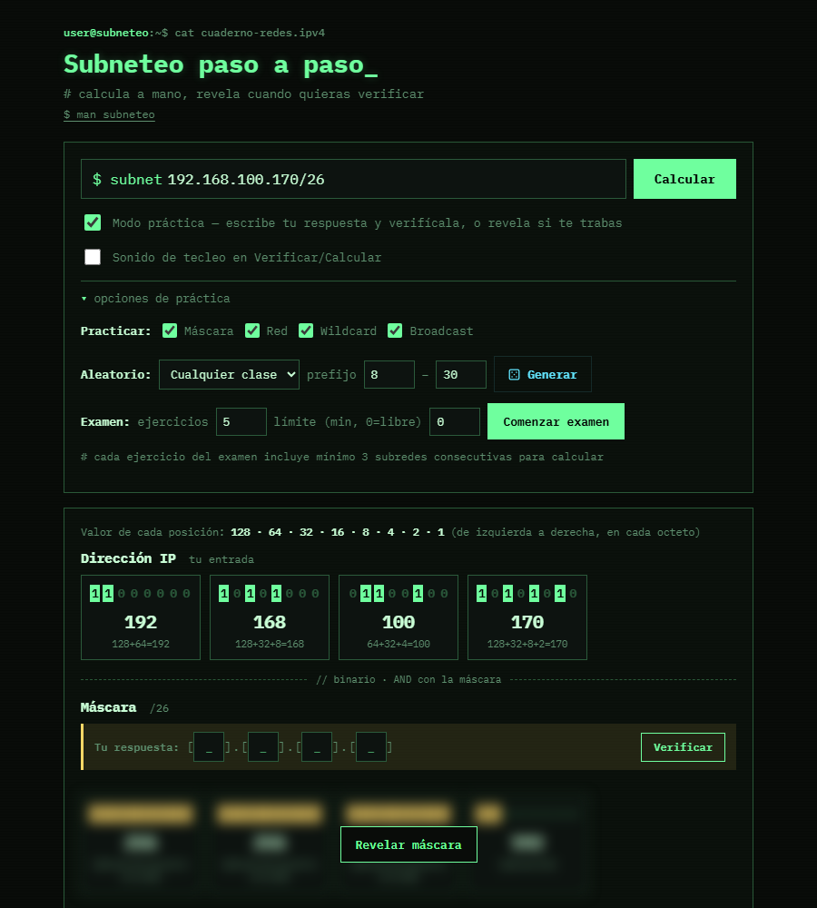

  <a href="https://github.com/Helminth117">
    <picture>
      <source media="(prefers-color-scheme: dark)" srcset="https://raw.githubusercontent.com/Helminth117/Helminth117/main/assets/icono-blanco-transparente.png">
      
    </picture>
  </a>

<h1 align="center">Subneteo paso a paso</h1>

Cuaderno interactivo para practicar subneteo IPv4: calcula a mano y revela cuando quieras verificar.

  
  
  

<a href="https://helminth117.github.io/subneteo-paso-a-paso/"><b>Abrir en el navegador</b></a>

Escribes una dirección con prefijo CIDR (por ejemplo `192.168.100.170/26`) y la página la desarma en
binario, octeto por octeto, con la suma de los pesos de cada bit (128 · 64 · 32 · 16 · 8 · 4 · 2 · 1).
En **modo práctica** cada resultado queda oculto: escribes tu respuesta en los cuatro octetos y la
verificas, o la revelas si te trabas.

## Qué calcula

| Paso | Cómo |
|---|---|
| Máscara | A partir del prefijo |
| Dirección de red | IP AND máscara |
| Máscara inversa (wildcard) | 255 − máscara |
| Broadcast | Red + wildcard |
| Resumen | Rango usable, hosts usables, tamaño de bloque y un diagrama del rango |
| Subredes consecutivas | Hasta 20 subredes seguidas, para resolver o ver en tabla |

Los prefijos /31 (enlace punto a punto) y /32 (host único) se tratan aparte.

## Para practicar

- **Pasos a elegir:** máscara, red, wildcard y broadcast se pueden practicar por separado.
- **Ejercicios aleatorios** por clase (A, B, C o cualquiera) y rango de prefijo.
- **Examen:** N ejercicios con límite de tiempo opcional; cada uno incluye al menos 3 subredes
  consecutivas, y al final muestra aciertos y respuestas reveladas.
- **Exportar sesión** y **copiar las subredes como notas** al portapapeles.
- Historial de los últimos cálculos, `man subneteo` con la ayuda y sonido de tecleo opcional.

## Uso

Es un único archivo: abre [`index.html`](https://helminth117.github.io/subneteo-paso-a-paso/) en el navegador, en línea o descargado. Solo
pide a internet la fuente IBM Plex Mono; sin conexión usa la monoespaciada del sistema.

---

  <a href="https://github.com/Helminth117">
    <picture>
      <source media="(prefers-color-scheme: dark)" srcset="https://raw.githubusercontent.com/Helminth117/Helminth117/main/assets/logotipo-blanco-transparente.png">
      
    </picture>
  </a>

